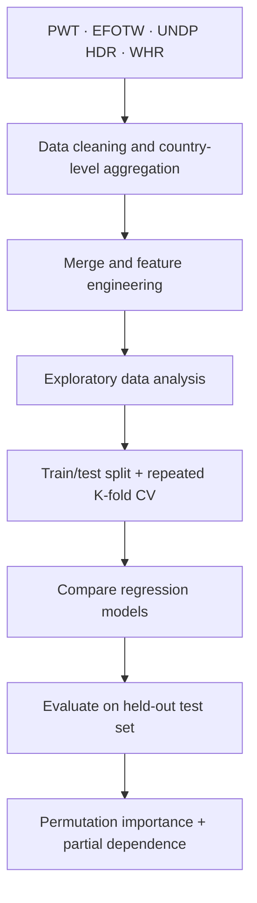

# Macroeconomic Stability Prediction Using Machine Learning

**Academic semester project | Introduction to Machine Learning | Brandenburg University of Applied Sciences | 2026**

A research-oriented machine learning project investigating whether macroeconomic growth volatility across countries can be predicted from institutional quality, human development, economic indicators, and subjective well-being.

> **Research question:** To what extent can macroeconomic stability be predicted from institutional quality, development indicators, and subjective well-being measures using regression and machine learning methods?

## Project overview

- **Sample:** 135 countries in the final cross-sectional dataset
- **Period:** 2010–2023 (annual indicators aggregated to country-level features)
- **Target:** `rgdpo_growth_std` — standard deviation of annual output-side real GDP growth; **lower values indicate greater stability**
- **Task:** Supervised regression, not GDP level forecasting or causal inference
- **Language & environment:** Python, Jupyter Notebook, pandas, NumPy, Matplotlib, scikit-learn; optional online-learning models via `river`

## Data sources (download separately)

The datasets are **not redistributed in this repository**. To reproduce the analysis, download the original files from the official providers listed below. The filenames refer to the editions used for this academic project, not necessarily the latest files offered on the websites.

| Data source | File used in the project | Official access page | Use in the project |
| --- | --- | --- | --- |
| Penn World Table **11.0** (University of Groningen) | `pwt110.xlsx` | [Penn World Table — Groningen](https://www.rug.nl/ggdc/productivity/pwt/) | Real GDP and growth-volatility target |
| Economic Freedom of the World **2025** (Fraser Institute) | `efotw-2025-master-index-data-for-researchers-iso.xlsx` | [Economic Freedom of the World — dataset](https://www.efotw.org/economic-freedom/dataset) | Institutional and economic-freedom indicators |
| Human Development Report **2025** (UNDP) | `HDR25_Statistical_Annex_HDI_Trends_Table.ods` | [UNDP — documentation and downloads](https://hdr.undp.org/data-center/documentation-and-downloads) (Table 2: HDI trends) | Human development indicators |
| World Happiness Report **2026** | `WHR26_Data_Figure_2.1.xlsx` | [World Happiness Report — data sharing](https://www.worldhappiness.report/data-sharing/) (2026, Figure 2.1) | Life evaluation and subjective well-being |

### Local data setup

1. Download the same **versions** of the four datasets from their providers. Some download pages may default to newer editions.
2. Create a `Data/` folder next to the notebooks, then place the downloaded files in it using the filenames in the table.
3. Run `1. Datenaufbereitung&Merge.ipynb` first to prepare the data and generate the derived dataset (`merged.csv`), then run the visualization and modeling notebooks. If notebook paths or output folders differ on your computer, adjust them locally.
4. Do not commit the downloaded datasets, `merged.csv`, or generated intermediate files unless their redistribution rights have been confirmed.

**Data credit:** All data are sourced from the respective organizations. Please consult and cite each provider's documentation, terms of use, and required attribution. Free access to download does not necessarily permit redistribution.

## Workflow



## Methods

The modeling notebook evaluates a mean-prediction baseline alongside linear and nonlinear regression methods, including Ridge Regression, SGD Regressor, Decision Tree, Random Forest and Gradient Boosting. It also discusses/implements optional online-learning regressors when the relevant `river` dependency is available.

- **Validation:** Repeated 5-fold cross-validation with 3 repeats on the training set
- **Selection criterion:** Mean cross-validation RMSE
- **Metrics:** RMSE, MAE and R²
- **Explainability:** Permutation feature importance and partial dependence analysis

## Results reported in the academic paper

The **SGD Regressor** achieved the lowest mean cross-validation RMSE (**0.0375**), closely followed by Ridge Regression (**0.0377**). On the held-out test set, SGD achieved:

| Metric | Reported value |
| --- | ---: |
| RMSE | 0.0299 |
| MAE | 0.0242 |
| R² | 0.333 |

These are **reported experimental results**, not an independently reproduced benchmark. The modest explained variance and weak/negative R² values across some validation folds are important limitations. Predictive associations should **not** be interpreted as causal effects.

## Repository structure

```text
├── README.md
├── 1. Datenaufbereitung&Merge.ipynb   # Download, clean and merge source data
├── 2. Visualisierung.ipynb           # Exploratory visualization
└── 3. Methods.ipynb                  # Regression modeling and evaluation
```

`Data/`, `merged.csv`, and `Datapreps/` are local input/output folders and are intentionally not published. The academic paper is also omitted from this portfolio copy.

## Running the notebooks

1. Install Python and create a virtual environment.
2. Install notebook and analysis dependencies, for example:

   ```bash
   pip install jupyter pandas numpy matplotlib scikit-learn openpyxl odfpy
   ```

3. For optional online-learning models, install `river` if compatible with your Python environment.
4. Download and place the original data into `Data/` following the [Local data setup](#local-data-setup) instructions above.
5. Open Jupyter Notebook in the project directory. Run notebooks in order: data preparation, visualization, methods.

**Reproducibility note:** The first notebook uses Windows-style relative paths and produces intermediate CSV files under `Datapreps/`. You may need to create that folder or adjust paths for your operating system. Some versions of the notebooks also depend on optional packages; review imports before running.

## Limitations

- Small cross-sectional sample (135 countries) limits generalization.
- Aggregation across 2010–2023 loses year-to-year dynamics.
- Predictive correlations do not establish causation.
- External datasets may carry redistribution and attribution requirements.

## Academic context and attribution

Completed as a **group semester project** for *Einführung in das maschinelle Lernen* at **Technische Hochschule Brandenburg**, supervised by **Prof. Dr. Artur Tarassow** (July 2026).

**Contributors:** Rick Pfennigschmidt, Tom Polewka, Nadine Ben Taziri.

This repository is intended for educational and portfolio purposes. Please cite the original data providers when reusing the research materials.
